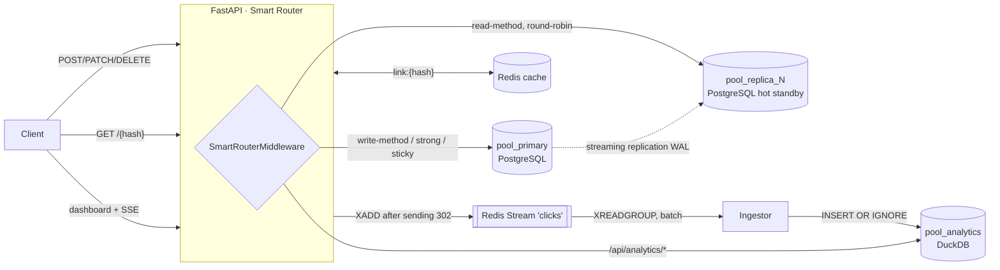

# Pathly

[Polski](README.md) · **English**

A link shortener built as a **playground for learning production architecture**: split reads and writes (primary /
read replica), an in-memory cache, an asynchronous event stream and a separate OLAP analytics database with a live
dashboard.



## Getting started

Requires Docker Desktop (on Windows with the WSL 2 backend).

```bash
cp .env.example .env
```

```bash
docker compose up --build
```

Dashboard: http://localhost:8000 · Swagger: http://localhost:8000/docs

Test traffic (registers the demo account from `.env`, creates 6 links and generates clicks with random user agents,
referrers and countries):

```bash
docker compose --profile sim run --rm simulator
```

Then log in to the dashboard with `DEMO_EMAIL` / `DEMO_PASSWORD` from `.env`.

## Optional: HTTPS at pathly.localhost

The repo includes a ready **Caddy** reverse proxy (`infra/caddy/Caddyfile`, `https` profile). It terminates TLS,
redirects `http://` to `https://` and passes SSE through without buffering. Browsers resolve `*.localhost` names to
`127.0.0.1` on their own.

Set `PUBLIC_BASE_URL=https://pathly.localhost` in `.env`, then:

```bash
docker compose --profile https up -d
```

The certificate is issued by Caddy's local CA, so the browser shows a warning until you trust its root certificate:

```bash
docker compose cp caddy:/data/caddy/pki/authorities/local/root.crt ./pathly-root.crt
```

```bash
certutil -user -addstore Root pathly-root.crt
```

Every install generates its own CA, which is why `pathly-root.crt` is in `.gitignore`. For a real domain just set
`PATHLY_DOMAIN` and remove the `local_certs` block from the Caddyfile, and Caddy will get a certificate from Let's
Encrypt on its own.

## Data paths

### Writes → `pool_primary`
Sign-up, login, creating and editing links. Hash uniqueness is guaranteed by a `UNIQUE` constraint in Postgres, not by
an application check: `INSERT … ON CONFLICT (hash) DO NOTHING RETURNING`, and on a random hash collision another
attempt (up to 6 times). Every link change invalidates its key in Redis, including the negative cache.

### Reads → Redis → `pool_replica_N` → fallback to primary
`GET /{hash}`:
1. `GET link:{hash}` in Redis: a hit returns 302 without touching the database (negative `!404` / `!410` entries with
   a short TTL protect the database from scans of non-existent hashes),
2. on a miss the `SELECT` goes to a replica (round-robin across healthy replicas),
3. if the replica doesn't have the link (a fresh write whose WAL hasn't arrived yet), it retries on the primary
   (**read-your-writes**),
4. the result goes into the cache with a TTL capped by the link's expiry date.

### Analytics → Redis Streams → DuckDB
The redirect handler **doesn't wait** for analytics: the event (`hash`, `ts`, `ip`, `user-agent`, `referrer`, a
country hint) goes to `BackgroundTasks` and is published with `XADD` only **after the 302 is sent**. The ingestor:
- reads with a consumer group (`XREADGROUP … COUNT 500 BLOCK 1000`) and does a batch insert,
- enriches data off the critical path: UA parsing (device, browser, OS, bot), referrer host, country (GeoLite2 if the
  file is present, otherwise the `CF-IPCountry`/`X-Country` header), `visitor_id = blake2b(salt, ip|ua)`, so **raw IPs
  never reach OLAP**,
- sends `XACK` only after a successful write, after a restart it first catches up on its own pending messages, and
  `XAUTOCLAIM` takes over messages abandoned by dead consumers,
- `event_id` (the stream ID) is the primary key in DuckDB, and `INSERT OR IGNORE` turns at-least-once delivery into an
  **exactly-once** effect.

The dashboard gets data through SSE (`/api/analytics/stream`), which refreshes after every ingestor flush (at most once
per second) or every 5 s so the time window keeps moving.

## Smart Router

`pathly/routing.py` is a plain ASGI middleware. It decides the route **before** the handler runs and stores it in a
`ContextVar`. The `SessionDep` dependency takes a session from the right pool.

| Rule (in order) | SQL pool | Reason in `X-DB-Route` |
|---|---|---|
| `POST/PUT/PATCH/DELETE` method | `pool_primary` | `write-method` |
| `X-Consistency: strong` header | `pool_primary` | `x-consistency:strong` |
| `pathly_rw` cookie (set for 3 s after every write) | `pool_primary` | `sticky-after-write` |
| other `GET` requests | `pool_replica_N` | `read-method` |
| `/api/analytics/*` path | additionally `pool_analytics` | `olap=analytics` |

Every response has `X-DB-Route` (the decision) and `X-DB-Pools` (the pools actually used) headers. The dashboard shows
them in the "Smart Router trace" panel.

Every 2 s the replica monitor compares `pg_current_wal_lsn()` on the primary with `pg_last_wal_replay_lsn()` on the
replica. A replica lagging more than `REPLICA_MAX_LAG_BYTES` or unavailable drops out of rotation, and when none is
left, reads go to the primary. Lag is measured in WAL bytes, not with `now() - pg_last_xact_replay_timestamp()`,
because the latter grows when the primary simply isn't writing anything.

## Experiments to try

```bash
docker compose stop postgres-replica-1
```
Reads switch to the primary, and in the pool panel `pool_replica_1` becomes "unavailable". After
`docker compose start postgres-replica-1` the replica comes back into rotation.

```bash
docker compose exec postgres-replica-1 psql -U pathly -c "INSERT INTO users(email,password_hash) VALUES ('x','y')"
```
The replica is physically read-only: `cannot execute INSERT in a read-only transaction`.

```bash
docker compose exec postgres-primary psql -U pathly -c "SELECT client_addr, state, sent_lsn, replay_lsn, replay_lag FROM pg_stat_replication"
```

```bash
curl -si localhost:8000/launch -H "X-Consistency: strong" | grep -i x-db
```

```bash
docker compose exec redis redis-cli XINFO GROUPS clicks
```

```bash
docker compose stop api
```
Clicks sent in the meantime and not acknowledged (`XACK`) will be processed after `docker compose start api`.

## API

| Method | Path | Description |
|---|---|---|
| POST | `/api/auth/register`, `/api/auth/login` | JWT (HS256), argon2id passwords |
| GET | `/api/auth/me` | data from the token, no database query |
| POST | `/api/links` | `{target_url, alias?, expires_at?}` |
| GET | `/api/links`, `/api/links/{hash}` | list / details (replica) |
| PATCH | `/api/links/{hash}` | `{target_url?, is_active?, expires_at?}` + cache invalidation |
| DELETE | `/api/links/{hash}` | click history stays in OLAP |
| GET | `/{hash}` | 302 / 404 / 410 |
| GET | `/api/analytics/stats?window=15m\|1h\|24h\|7d\|30d&hash=` | time series with gaps filled, referrers, devices, browsers, OS, countries, top links, delta to the previous window |
| GET | `/api/analytics/stream` | the same as Server-Sent Events |
| GET | `/api/analytics/totals` | clicks per link (all time) |
| GET | `/api/system` | pool status, replica lag, cache hit ratio, stream backlog |

## Decisions and trade-offs

- **DuckDB instead of ClickHouse.** A file-based OLAP with no separate server, columnar, with `time_bucket`,
  `count(DISTINCT …) FILTER` and `generate_series` for filling gaps. The price is **one writing process per file**, so
  the API runs as a single uvicorn worker that owns `pool_analytics` (writes through a dedicated cursor under a lock,
  reads through separate cursors in threads). Moving to ClickHouse would mean replacing `AnalyticsStore`, the rest of
  the system (stream, ingestor, API) stays the same.
- **Batch insert into DuckDB through JSON.** Passing Python lists as DuckDB parameters costs about 0.5 ms per element,
  so the batch goes as one JSON string unpacked with `from_json` + `unnest`. For 500 rows that is about 200× faster.
  Measured locally: about 100k rows/s written, and the full set of dashboard queries on 500k rows in 35-75 ms.
- **Redis Streams instead of RabbitMQ.** Redis is in the stack as a cache anyway, and Streams give consumer groups,
  ACKs, a pending list and message claiming, which is everything this ingestor needs.
- **Schema through `create_all`** on the primary at startup (the replica gets it through WAL). In a real project:
  Alembic.
- **302, not 301.** The browser doesn't remember the redirect, so every click goes through the server and reaches
  analytics.
- **`TRUST_PROXY_HEADERS=true`** is needed by the simulator (`X-Forwarded-For`, `X-Country`). Behind a real reverse
  proxy, trust only its address.
- **Geolocation:** after putting `GeoLite2-Country.mmdb` in the `analytics-data` volume (the `GEOIP_DB_PATH` path) the
  country is computed from the IP. Without the file the header hint or `ZZ` is used.

## Structure

```
docker-compose.yml               primary + replica-1 + redis + api (+ caddy in the https profile, simulator in the sim profile)
infra/caddy/                     TLS reverse proxy for pathly.localhost
infra/postgres/primary/          replication role, replica_1 slot, pg_hba
infra/postgres/replica/          pg_basebackup -R on first start, then hot standby
app/pathly/
  routing.py                     Smart Router (middleware + ContextVar)
  db.py                          SQL pools, round-robin, replica lag monitor
  cache.py                       link cache with negative entries
  events.py                      click event building + XADD
  enrich.py                      UA / referrer / country / visitor_id
  ingestor.py                    Redis Streams consumer → DuckDB
  analytics.py                   OLAP schema and queries
  routers/                       auth, links, redirect, analytics, system
  static/                        dashboard (Chart.js + SSE via fetch stream)
  tools/simulate.py              traffic generator
```

## License

[MIT](LICENSE) © 2026 Szymon Kaczmarczyk
