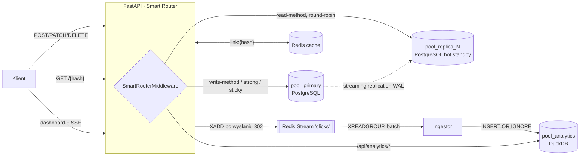

# Pathly

Skracacz linków zbudowany jako **poligon do nauki architektury produkcyjnej**: rozdzielenie zapisów i odczytów (primary / read replica), cache w pamięci, asynchroniczny strumień zdarzeń i osobna baza analityczna OLAP z dashboardem na żywo.



## Uruchomienie

Wymagany Docker Desktop (na Windowsie z backendem WSL 2).

```bash
cp .env.example .env
```

```bash
docker compose up --build
```

Dashboard: http://localhost:8000 · Swagger: http://localhost:8000/docs

Ruch testowy (rejestruje konto demo z `.env`, zakłada 6 linków i generuje kliknięcia z losowymi UA, referrerami i krajami):

```bash
docker compose --profile sim run --rm simulator
```

Potem zaloguj się w dashboardzie danymi `DEMO_EMAIL` / `DEMO_PASSWORD` z `.env`.

## Opcjonalnie: HTTPS pod pathly.localhost

W repo jest gotowy reverse proxy **Caddy** (`infra/caddy/Caddyfile`, profil `https`). Terminuje TLS, przekierowuje `http://` na `https://` i przepuszcza SSE bez buforowania. Nazwy `*.localhost` przeglądarki same rozwiązują na `127.0.0.1`.

Ustaw w `.env` `PUBLIC_BASE_URL=https://pathly.localhost`, a potem:

```bash
docker compose --profile https up -d
```

Certyfikat wystawia lokalne CA Caddy'ego, więc przeglądarka pokaże ostrzeżenie, dopóki nie zaufasz jego certyfikatowi głównemu:

```bash
docker compose cp caddy:/data/caddy/pki/authorities/local/root.crt ./pathly-root.crt
```

```bash
certutil -user -addstore Root pathly-root.crt
```

Każda instalacja generuje własne CA, dlatego `pathly-root.crt` jest w `.gitignore`. Dla prawdziwej domeny wystarczy ustawić `PATHLY_DOMAIN` i usunąć z Caddyfile blok `local_certs`, a Caddy sam pobierze certyfikat z Let's Encrypt.

## Ścieżki danych

### Zapisy → `pool_primary`
Rejestracja, logowanie, tworzenie i edycja linków. Unikalność hasha gwarantuje `UNIQUE` w Postgresie, a nie sprawdzenie w aplikacji: `INSERT … ON CONFLICT (hash) DO NOTHING RETURNING`, a przy kolizji losowego hasha nowa próba (do 6 razy). Każda zmiana linku unieważnia jego klucz w Redisie, łącznie z negatywnym cache.

### Odczyty → Redis → `pool_replica_N` → fallback na primary
`GET /{hash}`:
1. `GET link:{hash}` w Redisie: trafienie zwraca 302 bez dotykania bazy (negatywne wpisy `!404` / `!410` z krótkim TTL chronią bazę przed skanowaniem nieistniejących hashy),
2. przy chybieniu `SELECT` idzie na replikę (round-robin po zdrowych replikach),
3. jeśli replika nie ma linku (świeży zapis, którego WAL jeszcze nie dotarł), następuje ponowna próba na primary (**read-your-writes**),
4. wynik trafia do cache z TTL ograniczonym datą wygaśnięcia linku.

### Analityka → Redis Streams → DuckDB
Handler przekierowania **nie czeka** na analitykę: zdarzenie (`hash`, `ts`, `ip`, `user-agent`, `referrer`, podpowiedź kraju) trafia do `BackgroundTasks` i jest publikowane `XADD` dopiero **po wysłaniu 302**. Ingestor:
- czyta grupą konsumentów (`XREADGROUP … COUNT 500 BLOCK 1000`) i robi batch insert,
- wzbogaca dane poza ścieżką krytyczną: parsowanie UA (urządzenie, przeglądarka, OS, bot), host referrera, kraj (GeoLite2, jeśli jest plik, inaczej nagłówek `CF-IPCountry`/`X-Country`), `visitor_id = blake2b(salt, ip|ua)`, więc **surowe IP nie trafia do OLAP**,
- `XACK` wysyła dopiero po udanym zapisie; po restarcie najpierw dociąga własne pending, a `XAUTOCLAIM` przejmuje wiadomości porzucone przez martwych konsumentów,
- `event_id` (ID ze strumienia) jest kluczem głównym w DuckDB, a `INSERT OR IGNORE` sprawia, że dostarczenie at-least-once daje efekt **exactly-once**.

Dashboard dostaje dane przez SSE (`/api/analytics/stream`), który odświeża się po każdym flushu ingestora (nie częściej niż raz na sekundę) albo co 5 s, żeby okno czasowe się przesuwało.

## Smart Router

`pathly/routing.py` to czysty middleware ASGI. Ustala trasę **przed** wejściem do handlera i zapisuje ją w `ContextVar`. Dependency `SessionDep` bierze sesję z właściwej puli.

| Reguła (w kolejności) | Pula SQL | Powód w `X-DB-Route` |
|---|---|---|
| metoda `POST/PUT/PATCH/DELETE` | `pool_primary` | `write-method` |
| nagłówek `X-Consistency: strong` | `pool_primary` | `x-consistency:strong` |
| ciasteczko `pathly_rw` (ustawiane na 3 s po każdym zapisie) | `pool_primary` | `sticky-after-write` |
| pozostałe `GET` | `pool_replica_N` | `read-method` |
| ścieżka `/api/analytics/*` | dodatkowo `pool_analytics` | `olap=analytics` |

Każda odpowiedź ma nagłówki `X-DB-Route` (decyzja) i `X-DB-Pools` (pule faktycznie użyte). Dashboard pokazuje je w panelu „Trace Smart Routera”.

Monitor replik co 2 s porównuje `pg_current_wal_lsn()` na primary z `pg_last_wal_replay_lsn()` na replice. Replika z lagiem powyżej `REPLICA_MAX_LAG_BYTES` albo niedostępna wypada z rotacji, a gdy nie zostaje żadna, odczyty idą na primary. Lag mierzymy w bajtach WAL, a nie przez `now() - pg_last_xact_replay_timestamp()`, bo ta druga miara rośnie, gdy primary po prostu nic nie zapisuje.

## Eksperymenty do zrobienia

```bash
docker compose stop postgres-replica-1
```
Odczyty przełączają się na primary, a w panelu pul `pool_replica_1` staje się „niedostępna”. Po `docker compose start postgres-replica-1` replika wraca do rotacji.

```bash
docker compose exec postgres-replica-1 psql -U pathly -c "INSERT INTO users(email,password_hash) VALUES ('x','y')"
```
Replika jest fizycznie read-only: `cannot execute INSERT in a read-only transaction`.

```bash
docker compose exec postgres-primary psql -U pathly -c "SELECT client_addr, state, sent_lsn, replay_lsn, replay_lag FROM pg_stat_replication"
```

```bash
curl -si localhost:8000/launch -H "X-Consistency: strong" | grep -i x-db
```

```bash
docker compose exec redis redis-cli XINFO GROUPS clicks
```

```bash
docker compose stop api
```
Kliknięcia wysłane w tym czasie i niezatwierdzone (`XACK`) zostaną przetworzone po `docker compose start api`.

## API

| Metoda | Ścieżka | Opis |
|---|---|---|
| POST | `/api/auth/register`, `/api/auth/login` | JWT (HS256), hasła argon2id |
| GET | `/api/auth/me` | dane z tokena, bez zapytania do bazy |
| POST | `/api/links` | `{target_url, alias?, expires_at?}` |
| GET | `/api/links`, `/api/links/{hash}` | lista / szczegóły (replika) |
| PATCH | `/api/links/{hash}` | `{target_url?, is_active?, expires_at?}` + unieważnienie cache |
| DELETE | `/api/links/{hash}` | historia kliknięć zostaje w OLAP |
| GET | `/{hash}` | 302 / 404 / 410 |
| GET | `/api/analytics/stats?window=15m\|1h\|24h\|7d\|30d&hash=` | szereg czasowy z wypełnionymi lukami, referrery, urządzenia, przeglądarki, OS, kraje, top linki, delta do poprzedniego okna |
| GET | `/api/analytics/stream` | to samo jako Server-Sent Events |
| GET | `/api/analytics/totals` | kliknięcia per link (cały okres) |
| GET | `/api/system` | stan pul, lag replik, hit ratio cache, backlog strumienia |

## Decyzje i kompromisy

- **DuckDB zamiast ClickHouse.** Plikowy OLAP bez osobnego serwera, kolumnowy, z `time_bucket`, `count(DISTINCT …) FILTER` i `generate_series` do wypełniania luk. Cena to **jeden proces zapisujący na plik**, dlatego API działa jako jeden worker uvicorna i to on jest właścicielem `pool_analytics` (zapis przez dedykowany kursor pod lockiem, odczyty przez osobne kursory w wątkach). Przejście na ClickHouse oznaczałoby wymianę `AnalyticsStore`; reszta systemu (strumień, ingestor, API) zostaje bez zmian.
- **Batch insert do DuckDB przez JSON.** Przekazywanie list Pythona jako parametrów DuckDB kosztuje ok. 0,5 ms na element, więc batch idzie jako jeden string JSON rozpakowywany przez `from_json` + `unnest`. Na 500 wierszy to ok. 200× szybciej. Lokalnie zmierzone: ok. 100 tys. wierszy/s zapisu, a pełny zestaw zapytań dashboardu na 500 tys. wierszy w 35–75 ms.
- **Redis Streams zamiast RabbitMQ.** Redis i tak jest w stosie jako cache, a Streams dają grupy konsumentów, ACK, pending list i przejmowanie wiadomości, czyli wszystko, czego potrzebuje ten ingestor.
- **Schemat przez `create_all`** na primary przy starcie (replika dostaje go przez WAL). W prawdziwym projekcie: Alembic.
- **302, nie 301.** Przeglądarka nie zapamiętuje przekierowania, więc każde kliknięcie przechodzi przez serwer i trafia do analityki.
- **`TRUST_PROXY_HEADERS=true`** jest potrzebne symulatorowi (`X-Forwarded-For`, `X-Country`). Za prawdziwym reverse proxy ustaw zaufanie tylko do jego adresu.
- **Geolokalizacja:** po wrzuceniu `GeoLite2-Country.mmdb` do wolumenu `analytics-data` (ścieżka `GEOIP_DB_PATH`) kraj liczy się z IP. Bez pliku używana jest podpowiedź z nagłówka albo `ZZ`.

## Struktura

```
docker-compose.yml               primary + replica-1 + redis + api (+ caddy w profilu https, simulator w profilu sim)
infra/caddy/                     reverse proxy z TLS dla pathly.localhost
infra/postgres/primary/          rola replikacyjna, slot replica_1, pg_hba
infra/postgres/replica/          pg_basebackup -R przy pierwszym starcie, potem hot standby
app/pathly/
  routing.py                     Smart Router (middleware + ContextVar)
  db.py                          pule SQL, round-robin, monitor lagu replik
  cache.py                       cache linków z negatywnymi wpisami
  events.py                      budowa zdarzenia kliknięcia + XADD
  enrich.py                      UA / referrer / kraj / visitor_id
  ingestor.py                    konsument Redis Streams → DuckDB
  analytics.py                   schemat i zapytania OLAP
  routers/                       auth, links, redirect, analytics, system
  static/                        dashboard (Chart.js + SSE przez fetch stream)
  tools/simulate.py              generator ruchu
```
